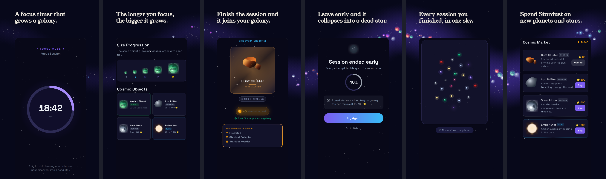
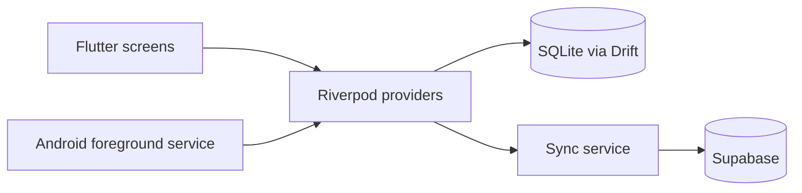

# Stellar Focus

A focus timer for Android. Each finished session puts an object in your own galaxy, and the length of the session decides how big it gets.

[Get it on Google Play](https://play.google.com/store/apps/details?id=com.stellarfocus.app)

The source code is private. This page explains how the app works and how it is put together.

## How it works

You pick a session length and an object from your inventory, then start the timer. The presets run from 5 to 180 minutes. When the session ends, the object joins your galaxy at a size tier set by the session length: anything under 21 minutes is tier 1, and tier 5 starts at three hours. A session of 180 minutes or more produces two objects instead of one.

Leave a session early and the object collapses into a dead star. It stays in your galaxy until you spend 100 Stardust to clear it.

Finished sessions earn Stardust, capped at 720 per session, which buys new objects in the Cosmic Market. Daily and weekly missions and a set of achievements give shorter goals on top of that.

## Architecture

The phone holds the real data. Sessions, owned objects and the Stardust ledger live in a local SQLite database (Drift), and the balance you see is the sum of that local ledger. The app works without a connection. Supabase is there for sign-in and for backing data up, so a new phone can restore an account.

### Backend

Supabase handles email and Google sign-in. Google sign-in uses the native account picker and hands its ID token to Supabase, so the user never leaves the app. Row-level security is on for every table: a user can only read and write their own rows. A database trigger also rejects ledger writes that the app itself would never make.

Two server functions check sessions. One registers a session when it starts and the other confirms it when it ends. This check fails open on purpose: only an explicit rejection from the server removes a reward. If the phone is offline or the server cannot be reached, the local reward stands, because losing a finished session to a bad connection would be worse than missing an occasional cheat.

### Rendering

The galaxy is painted on a Flutter canvas. Planets, stars and nebulae are shaded by three GLSL fragment shaders, which keeps them sharp at any screen density without image assets. Each object type also has a plain painter fallback for devices where the shaders do not load.

### Android

A foreground service written in Kotlin keeps the timer running while the app is in the background.

### State, navigation and tests

State management uses Riverpod with code generation, and routing uses go_router. The project has more than 160 automated unit and widget tests.

## Status

Live on Google Play since summer 2026. App blocking for Android is in development.

## How it is made

I decide what goes into each version, write the specs and test every build before it goes to Google Play. Most of the code is written with AI coding tools (Claude Code) from those specs.

Made by Kerem Mert at Kerch Labs. [LinkedIn](https://www.linkedin.com/in/keremmert06/)
